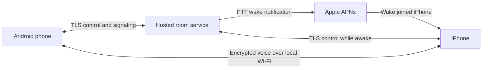

# Talkie Chatty research and implementation plan

Research date: November 6, 2026. Status: proposed implementation plan. No app has been built or device-tested as part of this research.

Build a phone-only Android and iOS walkie-talkie app for people on the same reachable Wi-Fi network, with reliable reception and transmission while the screen is locked or the app is in the background. Internet access for wake-ups is acceptable; a computer, Raspberry Pi, or other local server is not.

The recommended design is Flutter with native Swift and Kotlin lifecycle integrations, WebRTC for direct local audio, and a small hosted service for room membership, signaling, permission to speak, and Apple push notifications. Users need only their phones. The service still needs to be deployed and operated by the product owner. Internet carries control metadata; the proposed media policy keeps voice on Wi-Fi between participating phones. This design depends on internet for control and background wake-up and does not promise offline operation.

# Delivery estimate

These are engineering planning ranges for two active AI collaborators with daily integration, physical devices, credentials, and a human available for account actions and device tests. They are cumulative elapsed working time from project start, not AI inference time, fixed quotes, or store approval guarantees.

| Milestone | Estimated elapsed time | What it proves |
| --- | --- | --- |
| Foreground audio demonstration | 1–3 working days | Two real phones exchange intelligible voice on the LAN. |
| Background feasibility proof | 4–7 working days | Locked iPhone wakes through APNs; both platforms receive and transmit; first words survive the wake/connect delay. |
| Usable MVP | 3–5 weeks | Private rooms, 2–4 users, PTT arbitration, locked/background operation, recovery, permissions, basic security and honest status. |
| Broader beta | 5–7 weeks | Device/router coverage, headset routing, soak tests, measured battery use, onboarding, diagnostics, and a measured group limit. |
| Release candidate | 6–10 weeks | Signed release builds, store materials, privacy disclosures, dependency notices, operational runbook, and passed release gates. Store/account review time is additional. |

The largest schedule risk is integrating Apple's system PTT audio session with WebRTC during a cold wake. Reserve 1–2 weeks within the wider range for a native audio adapter or limited in-memory pre-roll if required. A failed feasibility gate triggers a revised estimate and explicit architecture decision; it does not permit silently dropping background behavior.

# Product scope

## First release

| Capability | Required behavior |
| --- | --- |
| Room creation | A user creates a private room and becomes its administrator. The room continues when that user's phone sleeps because coordination is hosted. |
| Joining | Scan an expiring QR invitation or paste the full invitation link. No public room directory or mandatory account. |
| Identity | User-chosen display name and an anonymous installation identity. Duplicate display names must remain distinguishable. |
| Room capacity | Prove 2 devices, then release initially for 2–4. Eight is an investigation target and may only be advertised after an eight-device test. |
| PTT | One speaker per room. Hold to talk in the app, release to stop, maximum 30-second burst by default, clear busy state. |
| Locked/background receive | A previously joined, permitted device can receive after the app is backgrounded and the screen locked. Idle intervals are part of testing. |
| Locked/background transmit | iOS system PTT controls and a valid Android system interaction start/stop speech. Android may use explicit start/stop notification actions rather than pretending a notification supports press-and-hold. |
| Readiness | Distinguish joined, wakeable, waking, ready, speaking, and unreachable. Show exactly which listeners are ready; never label a push submission as delivered audio. |
| Delivery policy | First release uses all eligible recipients ready before an in-app burst starts. If one cannot become ready within five seconds, fail visibly. Any sender may retry; only the administrator may remove the unavailable member. No silent partial delivery. System PTT requires equivalent audible-speech protection. |
| Audio | Mono voice, Opus through WebRTC, speaker and supported headset routes, echo/noise processing where supported, interruption handling. No video. |
| Reconnection | Re-establish control and media after a network interruption. Stop transmitting on uncertain floor ownership or network change. |
| Membership control | Administrator can rotate invitation, remove a participant, or close the room. Leaving releases microphone, audio routes, active grants, and platform session. |
| Permissions | Explain and request microphone, local network, camera only for QR, notifications/service permissions where applicable, and Bluetooth only for supported routes. |
| Diagnostics | User-visible reason codes and explicit export of redacted diagnostics. No voice, room secrets, or push tokens in logs. |
| Accessibility | Large talk target, screen-reader labels, text scaling, state communicated without color alone, and distinct accessible start/stop actions. |
| Privacy | No audio recording, transcription, ads, contact upload, or location history. Any short audio pre-roll exists only in RAM, only after a user transmit action, and is erased after delivery or cancellation. |

## Deferred features

Full-duplex conference mode, unlimited groups, cross-location/cellular voice, TURN or SFU media relay, offline background operation, Bluetooth/Wi-Fi Direct transport, automatic local room discovery, persistent chat, recording, transcription, emergency priority, accounts, organization administration, subscriptions, desktop/web clients, and wearable/headset PTT buttons are separate later scopes.

Ordinary Bluetooth audio is in beta testing; arbitrary headset button support is a different feature. A one-to-one room is simply a room with two people. Users participate in one active room at a time in the first release.

# Research findings

## Reusable components

The entries below are candidates, not a build-tested dependency lock. Pin specific releases and native binaries after the feasibility builds, record their licenses, and retain required notices. Recent repository activity does not prove platform compatibility.

| Resource | License or status | How to use it |
| --- | --- | --- |
| [Flutter WebRTC](https://github.com/flutter-webrtc/flutter-webrtc) | [MIT plugin](https://github.com/flutter-webrtc/flutter-webrtc/blob/main/LICENSE); Android and iOS support; repository activity observed in October 2026 | Preferred cross-platform media wrapper. Reuse voice transport and native WebRTC. Build room coordination, PTT, lifecycle adapters, and UI around it. |
| [WebRTC core](https://webrtc.googlesource.com/src/+/refs/heads/main/LICENSE) and [Opus](https://opus-codec.org/license/) | BSD-style licenses and Opus's published patent terms; audit bundled third-party notices separately | Reuse codec, jitter handling, encrypted media, and available audio processing. Do not implement a new codec or RTP stack. |
| [Bonsoir](https://github.com/Skyost/Bonsoir) | [MIT](https://github.com/Skyost/Bonsoir/blob/main/LICENSE); wraps Bonjour and Android NSD | Optional later LAN discovery. Not required when QR/cloud room invitations already identify participants. Discovery does not authenticate peers. |
| [LiveKit](https://github.com/livekit/livekit) and [Flutter SDK](https://github.com/livekit/client-sdk-flutter) | Apache-2.0 | Strong alternative for server-relayed group audio. A cloud SFU moves voice off the LAN; a LAN SFU needs the local hardware the user excluded. Keep as a future architecture option. |
| [Mumble](https://github.com/mumble-voip/mumble) | BSD-style core | Study PTT, channels, and low-latency voice behavior. The [official download page](https://www.mumble.info/downloads/) marks its iOS app unmaintained with a last update in 2017, so this is not a credible immediate cross-platform rebrand. |
| [Mumla](https://github.com/quite/mumla) | GPLv3 Android client | Useful behavior reference. Do not copy its implementation into a differently licensed product without an explicit license decision. |
| [Nearby Connections](https://developers.google.com/nearby/connections/overview) | Android and iOS offline transport; SDK terms and Google Play services dependencies need separate review | Potential no-router transport later. It is not an audio engine and does not solve mobile lifecycle restrictions. |
| [Jitsi Meet](https://github.com/jitsi/jitsi-meet) | Apache-2.0 meeting stack with mobile SDKs | Better suited to conferencing. Its UI/server scope and media routing are a poor first fit for this small LAN PTT product. |

WebRTC intentionally leaves application signaling outside its specification, so an authenticated room/signaling service is genuine project work. [WebRTC peer connections guide](https://webrtc.org/getting-started/peer-connections).

ICE includes local host candidates, which makes direct LAN communication without a public STUN/TURN service plausible. The actual result depends on routes, firewalls, and native library behavior and must be demonstrated on devices. [ICE specification](https://www.rfc-editor.org/rfc/rfc8445.html#section-5.1.1.1).

## iPhone behavior

Use Apple's PushToTalk framework and a Swift bridge, including channel restoration and the platform-managed audio session. Joined idle apps can be suspended, so a permanent Flutter socket is not the wake mechanism. Apple's system provides lock-screen interaction and APNs-based background activation. The app supplies the actual audio transport. [Apple PushToTalk introduction](https://developer.apple.com/videos/play/wwdc2022/10117/).

PTT push tokens are tied to the joined channel. The backend must manage token replacement/invalidation and use the documented PTT notification type. Incoming native callbacks must be handled promptly, and WebRTC must not independently fight the system for audio-session activation. [Creating a Push to Talk app](https://developer.apple.com/documentation/pushtotalk/creating-a-push-to-talk-app).

Apple also documents local push connectivity for restricted networks, with an App Push Provider entitlement and a persistent connection to a local server. That is a real later option for offline use, but it does not fit this first release's no-local-server requirement. [Local push connectivity](https://developer.apple.com/documentation/networkextension/local-push-connectivity).

The system's activation sound is not proof that remote phones have connected. The first real-device experiment must test speech immediately after that sound. Do not assume WebRTC saves audio produced before a peer connection exists. A bounded RAM audio buffer may be needed; do not add a custom competing iOS activation chime. This is an integration risk, not a solved SDK feature.

Declare the microphone and local-network purpose strings, and complete local-network permission onboarding while the app is foregrounded. An undetermined local-network permission can cause a background operation to fail without showing a prompt. Bonjour service declarations apply if discovery is later added. [Apple local-network privacy](https://developer.apple.com/documentation/technotes/tn3179-understanding-local-network-privacy).

## Android behavior

Use a Kotlin lifecycle adapter and a legitimate communication foreground service started from an allowed user interaction, with a visible ongoing notification. Microphone access is subject to while-in-use and foreground-service rules; a background callback cannot simply open the microphone whenever it wishes. Select and document applicable service types instead of labeling voice work as data sync. [Android foreground service types](https://developer.android.com/develop/background-work/services/fgs/service-types), [background start restrictions](https://developer.android.com/develop/background-work/services/fgs/restrictions-bg-start).

For apps targeting Android 17/API 37 or higher, current Android documentation requires runtime local-network permission for this kind of socket traffic. The older Android 16 opt-in model is not the current target-37 behavior. [Android local-network permission](https://developer.android.com/privacy-and-security/local-network-permission).

Newer Android releases also restrict audio focus and background audio: Android 15+ targets need top-app or foreground-service status to request audio focus, and Android 17 adds background audio checks. Include the target-SDK behavior in the service/audio spike. [Android audio focus](https://developer.android.com/media/optimize/audio-focus), [Android 17 background audio](https://developer.android.com/about/versions/17/changes/bg-audio).

Doze and vendor battery policies remain real-device test cases even with a foreground service. If Android needs an additional platform wake mechanism for supported states, specify it through a phase-zero decision with its delivery limits; do not treat a persistent socket as an unconditional guarantee. [Android Doze guidance](https://developer.android.com/training/monitoring-device-state/doze-standby).

## Supported operating conditions

The release promise applies after the user has opened the app, granted permissions, and joined a room, with working internet control access and mutually reachable Wi-Fi peers. Test backgrounded and locked devices separately from user force-stop, explicit leave, reboot, app termination by the OS, or lost connectivity. Force-stop, power-off, disabled permissions, and explicit leave must never show as successful delivery.

Proposed platform floors are iOS 16+ for PushToTalk and Android 10+ to limit the initial compatibility matrix, subject to the pinned dependency and device checks. Build/target SDK requirements are separate from those minimum versions and must be checked at release time. Do not promise support for an OS version tested only in a simulator.

Same SSID does not prove peer reachability: guest isolation, VLANs, client firewalls, VPNs, and enterprise policies may prevent direct audio. A shared hotspot is a separate tested configuration, not an automatic promise. Wi-Fi range comes from the access point/network; this does not turn phones into independent long-range radios.

# Architecture

The cloud service owns membership and speaking permission. It never relays or stores voice in this design. An administrator's phone can sleep without ending the room.

## Technology choices

- Flutter/Dart application with a narrow platform bridge.
- flutter_webrtc for peer media; Swift for Apple PushToTalk/audio lifecycle; Kotlin for Android service/audio lifecycle.
- Small Go service for HTTPS/WSS room APIs, WebRTC signaling relay, authoritative floor control, APNs dispatch, and bounded operational metrics.
- One active coordinator instance for the first release, with serialized room state. Persist session/token records securely as needed for channel restoration; expire all old floor grants after restart. Avoid distributed floor ownership until it is justified.
- Managed TLS and a secrets store for service credentials. An APNs key belongs on the service, never in the app.
- Schema-generated Dart/Go models and shared fixtures from one versioned contract source.
- Initial join by QR/full invite link. No mDNS, SSID collection, location permission, or local TLS provisioning required just to discover a room.

The API may be reachable through cellular for control, while the media engine must use Wi-Fi. Current flutter_webrtc native source exposes network-interface filtering on both platforms, but the exact pinned release and selected routes must be verified. [Native implementation reference](https://github.com/flutter-webrtc/flutter-webrtc/blob/5ee7ac5eb5ad049b1ef847244c566ce2d7fe235e/common/darwin/Classes/FlutterWebRTCPlugin.m#L507).

Configure no external STUN/TURN servers or media relay. Filter allowed local candidates and validate the selected candidate pair and interface before sending voice. A host-type candidate alone is insufficient proof of LAN routing, particularly with IPv6 or VPN interfaces. Test Wi-Fi with cellular enabled, VPN enabled, and route changes. The first milestone may support tested IPv4 LANs; IPv6-only support is a separate gate and must be disclosed if deferred.

For four users, a complete peer mesh has six peer connections, three per device. For eight, it has 28, seven per device. During one burst the speaker sends to the other N−1 phones. Sleeping receivers may need fresh connections, so idle links must not be assumed alive. These counts are topology calculations, not measured capacity claims.

## A speech burst

1. The user presses PTT. The client requests a floor reservation for a new burst.
2. The coordinator atomically reserves the room for that sender, records a unique burst ID, and returns busy to competing senders.
3. It wakes joined iPhone listeners via APNs and notifies awake clients. A sleeping listener remains a member even when its WebSocket is disconnected.
4. Receivers activate the permitted platform audio session, reconnect authenticated signaling, and establish local peer media.
5. Each receiver acknowledges readiness for that exact room generation and burst. Readiness requires an established peer/DTLS connection, an attached remote track, initialized native playout, and a usable platform audio session, not simply ICE connectivity or notification receipt.
6. The app enables transmission only under a fresh grant and the declared readiness policy. System PTT must preserve speech after Apple's sound using a proven native integration or bounded RAM pre-roll.
7. Release, cancel, interruption, lease loss, route change, or the burst limit stops audio and releases the floor.
8. Audio is rendered only for the authorized sender. Stale pushes, offers, and grants cannot revive an old burst.

Snapshot intended recipients when reserving the floor: all joined/wakeable members except the sender, including suspended members. New joins participate in the next burst. An explicit leave/removal before speech starts cancels preparation and requires a fresh snapshot; during speech it disconnects that member immediately. Zero recipients fails visibly. The preparation reservation lasts at most five seconds and cannot extend indefinitely. The separate three-second renewable transmission lease starts only when the active grant is issued.

# Shared contracts

Agent A owns the canonical contract; Agent B reviews it before implementation and consumes generated models. Freeze v0.1 after phase zero. Changes require a written compatibility note, fixture update, and both agents' acknowledgement before consumers change.

| Contract area | Required definition |
| --- | --- |
| Envelope | protocolVersion, roomId, roomEpoch, participantId, requestId, messageType, serverSequence; burstId and grantId where applicable. The authenticated session determines identity; do not trust a claimed sender ID. |
| Membership | createRoom, joinRoom, leaveRoom, removeParticipant, closeRoom, rotateInvite. Explicit distinction between joined membership, socket online state, and audio readiness. |
| Wake registration | Register/replace channel token with APNs environment and channel identity; revoke on leave; remove invalid tokens on provider response. Tokens never appear in peer messages or logs. |
| Signaling | Bounded SDP/ICE relay only between current room members; deterministic offerer selection; buffer early ICE correctly; reject stale room/burst generations and malformed or oversized payloads. |
| Floor | request, reserve, busy, grant, renew, release, revoke, expire. Only one reservation/grant owner per room. Server restart creates a new epoch and invalidates previous grants. |
| Readiness | waking, audioReady, unavailable, deadlineExceeded; every acknowledgement binds to the current burst and authenticated participant. |
| Client state | idle, joining, joinedWakeable, waking, ready, requesting, transmitting, receiving, reconnecting, leaving, failed. Visual state never invents transport success. |
| Errors | MIC_DENIED, LAN_DENIED, ROOM_FULL, INVITE_EXPIRED, BUSY, WAKE_TIMEOUT, PEER_UNREACHABLE, AUDIO_INTERRUPTED, CONTROL_OFFLINE, PROTOCOL_MISMATCH. |
| Bounds | Candidate defaults: four users, 30-second burst, five-second wake/readiness deadline, three-second active transmission lease renewed each second, 15-minute invitations. Finalize timing constants from phase-zero measurements. |
| Time | Server owns floor decisions; clients use monotonic watchdogs. Sequence/epoch validation and conservative expiry prevent stale grants from extending transmission. Do not compare unsynchronized wall clocks. |

Persisted membership may outlive idle socket heartbeats. A socket timeout can revoke a speaker's grant without silently ejecting a sleeping listener. Membership expires through explicit leave, channel invalidation, administrator removal, or the documented maximum session policy.

# Privacy and security scope

Authenticate all control connections; use high-entropy invitation capabilities and short-lived membership credentials. Use separate administrator credentials, rate limits, payload limits, schema validation, and per-room authorization. A short human-readable code is not sufficient authentication by itself.

WebRTC protects media links; authenticated signaling is still essential because it communicates peer identities and session fingerprints. The signaling service is trusted in the first release. Do not market the product as independently verified end-to-end encryption against a malicious service without a separate peer-identity design and review.

Store installation credentials in platform secure storage. Explicitly test that required channel configuration and credentials are available to an OS-restored app while locked after a prior device unlock; an unlocked-only storage policy can break background restoration. Use the narrowest appropriate accessibility class. Reboot before the first unlock is outside the ordinary locked-use guarantee. Restrict access to APNs tokens and credentials, redact IP/SDP data from routine logs, retain only bounded operational metadata, and document deletion/retention behavior. A removed participant must lose signaling rights and be disconnected by every remaining peer; rotate invitations to prevent re-entry.

No microphone capture before a user-authorized transmission, no silent playback used to keep iOS awake, no permissive certificate bypass, no voice uploaded to cloud telemetry, and no automatic public relay fallback.

# Implementation phases

| Phase | Work and outputs | Owner A | Owner B | Exit gate |
| --- | --- | --- | --- | --- |
| 0 — Feasibility, days 1–7 | Device/SDK inventory, protocol sketch, direct audio sample, real APNs PTT wake, Android service proof, route evidence, cold speech experiment | Minimal hosted control/APNs harness; fixtures; timing and network measurement | Flutter/native spike; real-device receive/transmit and audio-session integration | Locked receive and locked transmit both demonstrated; first words preserved; routes verified. Record failures and revised estimate before expanding UI. |
| 1 — Foundation, week 2 | Repository structure, locked dependencies, generated contracts, CI, room lifecycle, authentication, basic app shell | Room APIs, credentials, signaling, floor state machine, contract generation | Join/create UI, secure storage, SDK adapters, permission flows | Two real phones join securely and exchange authorized foreground bursts; invalid joins and contention fail correctly. |
| 2 — MVP, weeks 3–5 | 2–4 user rooms, complete PTT/wake/recovery, system controls, participant readiness, safety limits | APNs lifecycle, room persistence, limits, retries, epochs, metrics | Native restoration, audio gating, disconnect recovery, locked controls, accessible status | Device matrix meets MVP gates; no silent receive failure, stale-floor audio, or clipped first utterance. |
| 3 — Beta, weeks 5–7 | OEM/router expansion, audio routes, battery/thermal/long idle tests, onboarding polish, optional eight-user trial | Load/fault tests, operations runbook, privacy retention, dependency inventory | Bluetooth/wired route tests, interruption/UI polish, permission denial/recovery | Measured supported device/network/capacity list and reproducible regression results. |
| 4 — Release, weeks 6–10 | Signed builds, privacy/store disclosures, licenses, support documentation, production deployment plan | Integration review, backend rollout/rollback, release evidence, service monitoring | Android/iOS release builds, app metadata/screenshots, platform checks | All gates pass on release builds; submission-ready packages and rollback plan. Public submission/deployment occurs only in the implementation scope authorized then. |

Parallel work is limited by the contract and native feasibility gates. A working foreground UI is not sufficient to pass phase zero or declare an MVP.

# Two collaborator work split

## Agent A — This assistant

Own backend behavior, shared contracts, protocol/security decisions, integration verification, and release coordination.

Exclusive paths proposed for implementation:
- services/control/**
- contracts/**
- packages/protocol/**
- infrastructure/**
- tests/system/**
- docs/architecture/**, docs/operations/**, docs/verification/**
- root CI and root workspace configuration

Deliver in order: contract/fixtures and tiny wake harness; authenticated rooms and signaling; authoritative floor logic; production APNs registration/dispatch; bounded persistence and reconnect handling; automated fault tests; release evidence and operational documentation.

Do not implement the mobile UI, edit Swift/Kotlin lifecycle code, fork the media library, add an SFU/TURN service, require a LAN appliance, or change user-facing scope without a documented joint decision. Request the relevant change from Agent B. Owning integration does not authorize overwriting B's files.

Agent A is done only when generated contracts are reproducible, room/floor/auth tests pass, APNs errors and restarts behave correctly, real-device evidence matches the release claims, and service build/run/rollback commands are documented.

## Agent B — Collaborating AI

Own the Flutter app, peer media implementation, native platform lifecycle, device-facing behavior, and mobile build artifacts.

Exclusive paths proposed for implementation:
- apps/mobile/**
- packages/ptt_platform/**
- packages/lan_audio/**
- tests/mobile/**
- docs/mobile/**
- app-specific dependency/lock files, manifests, entitlements, signing configuration templates

Deliver in order: native PTT/audio/foreground-service spike; proof of cold speech behavior; app and native bridges; real signaling integration and Wi-Fi media policy; accessible room/PTT UI; interruption/permission/reconnect handling; device test results; signed-build instructions and release artifacts when credentials are supplied.

Do not build a separate server, reimplement protocol models, invent endpoints, grant speaking permission locally, add room discovery/account/chat/recording features, upload voice to the internet, disable certificate verification, or represent a simulator test as background verification.

Agent B is done only when physical Android/iPhone builds implement the agreed contract, both locked receive and locked transmit pass, media route evidence exists, microphone use stops correctly, and the app reports actual server/transport state.

## Integration rules for both agents

Work in separate branches/worktrees with one file owner. Merge small vertical changes against the same contract version; integrate daily. Review each other's changes at module boundaries. Report conflicts instead of overwriting another working tree.

Every task ticket states its ID, phase, owner, allowed paths, input contract version, deliverables, acceptance commands/scenarios, exclusions, and dependencies. Handoffs include commit ID, changed files, observed results, device/OS/build IDs, known failures, and untested assumptions.

No fabricated SDK APIs, test outcomes, background guarantees, release versions, or package capabilities. Verify unfamiliar APIs in the pinned source or official docs. Mocks are permitted for isolated tests and UI development, never as evidence that cross-platform audio or wake-up works.

A required result that cannot be demonstrated stays open. Raise a concise decision record with evidence and options; do not silently substitute internet audio, a local server, foreground-only behavior, or weaker security.

# Verification and release gates

These are proposed measurable targets, not measured current performance.

| Area | Required evidence |
| --- | --- |
| Basic interoperability | Android→iOS, iOS→Android, Android→Android, iOS→iOS, then four mixed devices. At least two iPhones and two Android phones for initial coverage. |
| Long idle | Repeated wake/receive after 1, 15, and 60 minutes locked; separately test transmit from locked controls, OS-restored process, user force-stop, and reboot behavior. |
| Cold speech | A one-second phrase begun at the permitted system/UI cue arrives intact. Test native iOS PTT and in-app PTT independently. |
| Latency | Target warm mouth-to-ear p95 ≤250 ms and cold press-to-ready p95 ≤2 seconds on healthy test Wi-Fi/internet. Five-second hard failure deadline. Set final targets from phase-zero data. |
| Reliability | Beta target ≥99% complete deliveries across at least 1,000 measured attempts under declared supported conditions. Report denominator, idle mix, failures, and percentiles; a timeout is not success. |
| Contention | Automated simultaneous requests, duplicate messages, delayed grants, and reconnects produce no overlapping accepted floor owners. Receivers do not render unauthorized senders. |
| Network failures | Wi-Fi roam/off, internet loss, AP isolation, VPN, cellular present, expired invitation, cloud restart, and stale APNs/ICE. No silent cellular/TURN fallback. |
| Audio lifecycle | Call/assistant/alarm interruptions, wired/Bluetooth changes, route loss, permissions revoked, app leave, and maximum-burst expiry stop or recover safely. |
| Group capacity | Four phones before first MVP; eight real phones before advertising eight. Synthetic peers supplement but do not replace hardware tests. |
| Soak and battery | Four-hour joined session and repeated bursts; no stuck microphone, crash, unbounded memory growth, or serious thermal state. Record battery drain versus idle baseline by device and set a documented release budget. |
| Security | Cross-room attempts, forged sender IDs, revoked members, stale tokens, malformed/oversized messages, replay, rate limiting, secrets/log inspection, and restart epoch behavior. |
| Delivery artifacts | Exact commit/build IDs, installable Android artifact, iOS archive/TestFlight build as provisioning permits, dependency notices, device matrix, known limitations, and operations runbook. |

The test network must allow peer traffic. Record access point/router configuration, internet availability, and the chosen media candidate/interface. Server-side push acceptance alone is not proof of wake, ready state, or audible delivery.

# Budget and prerequisites

Use a Mac with compatible Xcode, an Apple developer account with PTT/push provisioning, a Google Play account for store distribution, a small hosted HTTPS service/domain, and real phones. Start with two iPhones and two Android devices; borrow more only for an expanded capacity claim. Device access and account provisioning are on the critical path.

Apple lists USD 99 per membership year, with regional variation; Google lists a USD 25 one-time Play Console registration fee. [Apple enrollment](https://developer.apple.com/programs/enroll/), [Play Console registration](https://support.google.com/googleplay/android-developer/answer/6112435?hl=en-EN).

For a small pilot, reserve approximately USD 10–50/month for control-service hosting, logs, and related infrastructure. This is an engineering budget allowance, not a provider quote; choose a provider and confirm cost before deployment. Hardware, domain, AI usage, taxes, and larger-scale operations are additional. Direct LAN voice avoids cloud media bandwidth, but control availability and push delivery still require ongoing operations.

# First implementation assignment

Start both collaborators on phase zero only. Agent A supplies the smallest secure control/APNs test service and shared message fixtures. Agent B supplies the smallest native-backed app that joins, sleeps, wakes, connects local voice, and transmits from system controls. Produce a physical-device recording/timing report and candidate-route evidence before committing to the full app UI or the final schedule.

